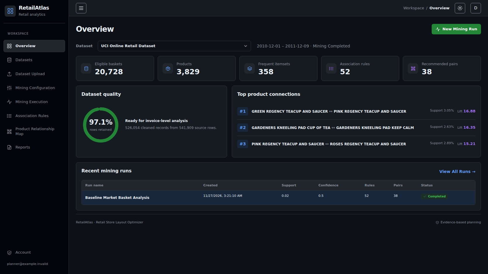
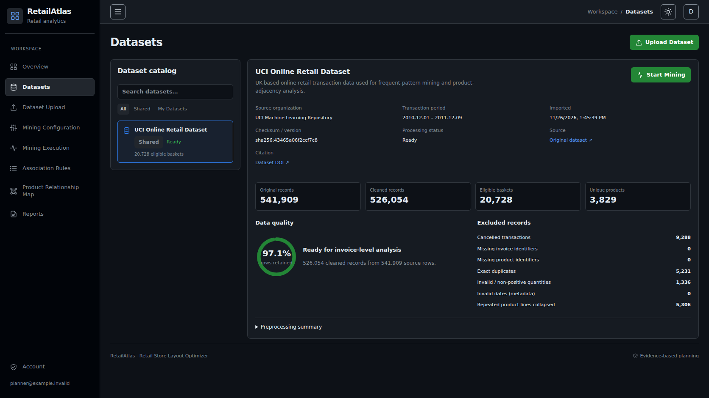
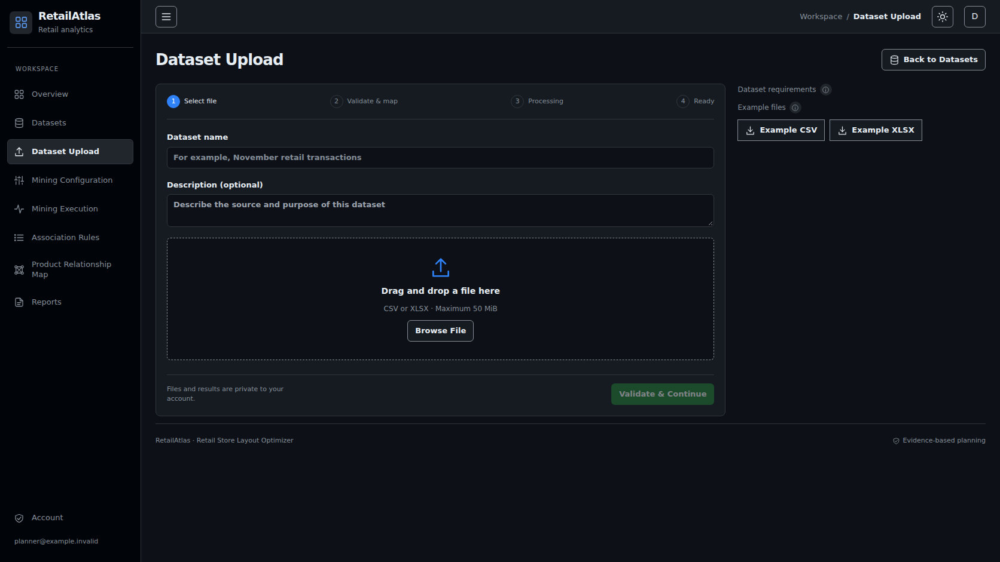
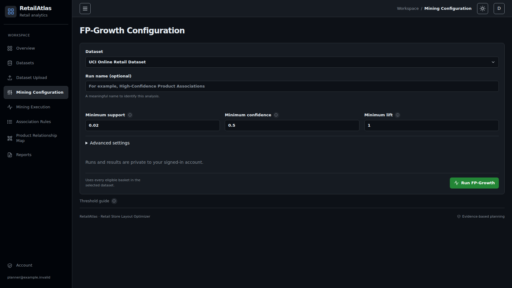
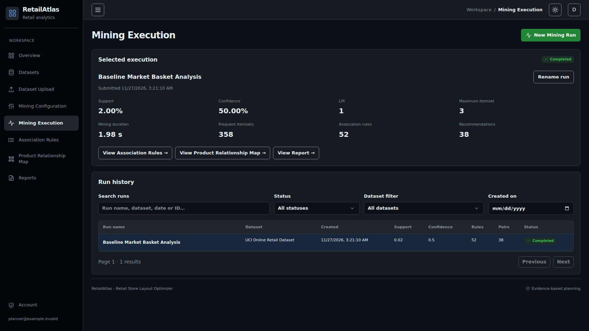
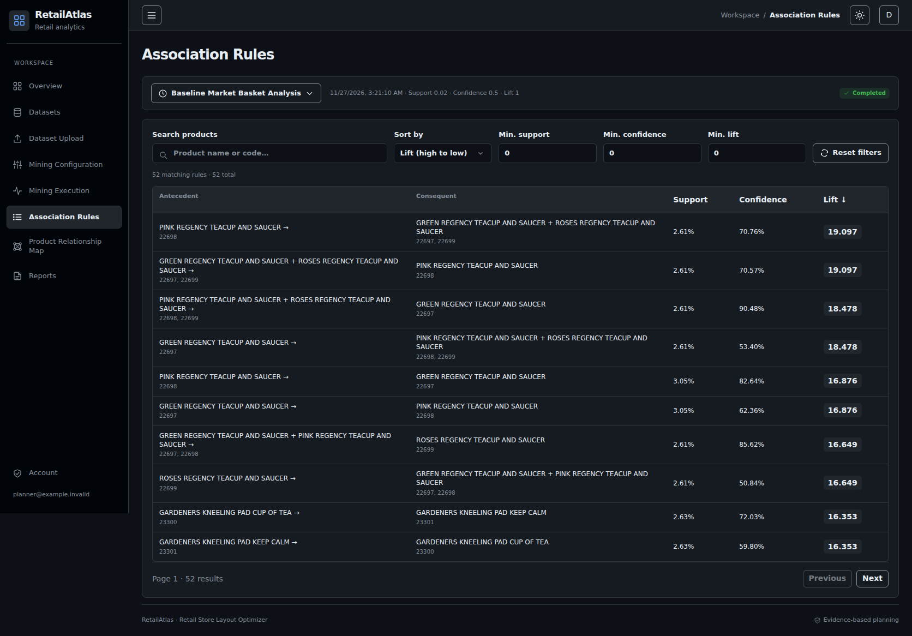
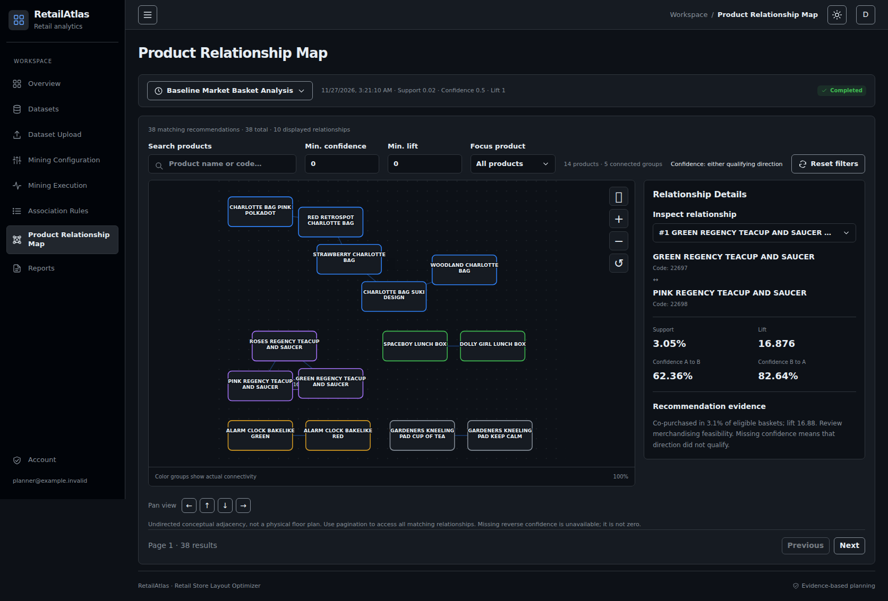
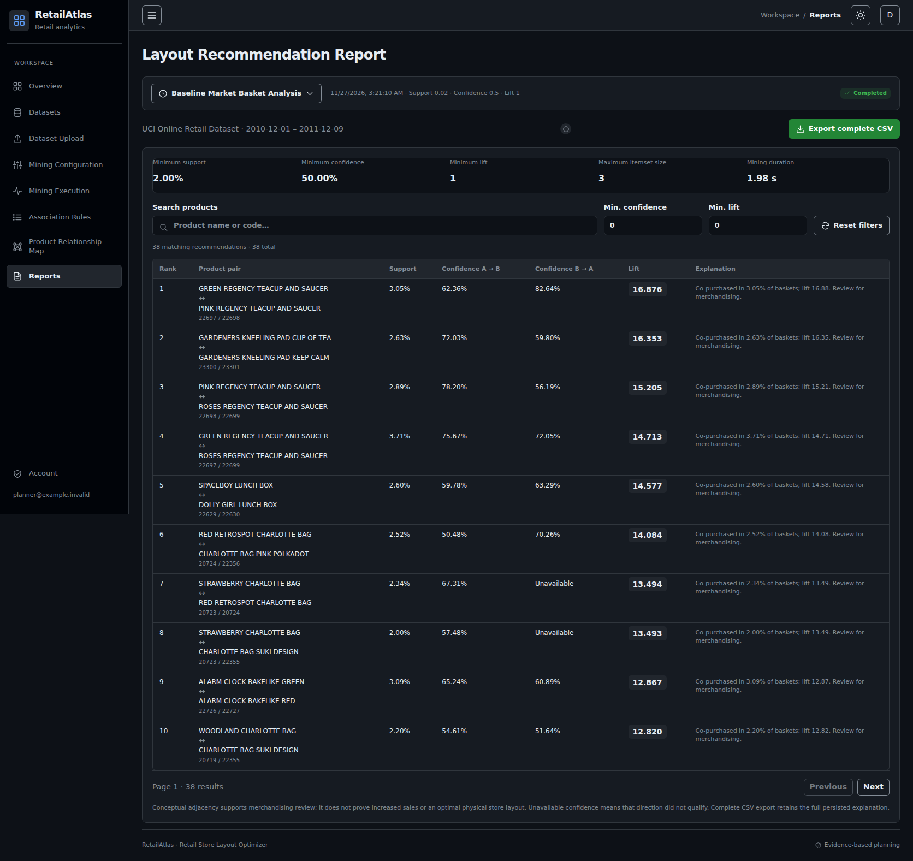
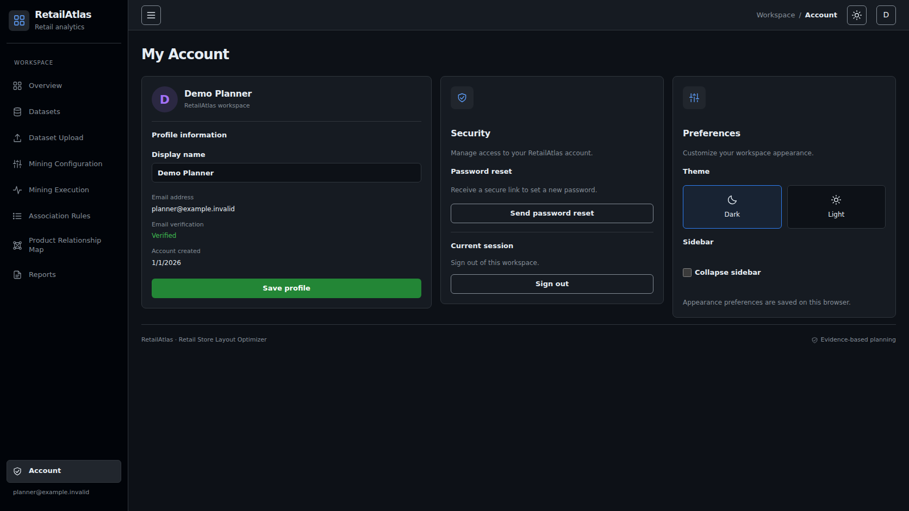

# RetailAtlas

Retail Store Layout Optimizer: invoice-level FP-Growth analysis with explainable product-adjacency recommendations. React/JavaScript and FastAPI, backed by Supabase PostgreSQL and Authentication.

## Features

- Nine focused workspace pages with a responsive GitHub Dark shell and light theme.
- Private CSV/XLSX uploads, bounded previews, explicit column mapping and dataset quality/provenance.
- Validated mining parameters, duplicate-safe submissions, persisted execution states and searchable history.
- Directional association rules, an interactive undirected relationship map and complete-run CSV exports.
- Account ownership checks, verified JWTs, profile/security preferences and protected shared UCI data.

Recommendations support merchandising review; they do not prove increased sales or an optimal physical floor plan.

## Application Screenshots

Actual Chromium captures of the implemented UI. Gallery uses verified public UCI aggregate fixtures and a sanitized demonstration profile. [Workflow evidence and capture details](docs/improvement-report.md#j-screenshot-gallery) distinguish real API tests from controlled UI states.

### Overview


### Datasets


### Dataset Upload


### Mining Configuration


### Mining Execution


### Association Rules


### Product Relationship Map


### Reports


### Account


## Stack and architecture

React 19, JavaScript, Vite, Tailwind, Radix UI, TanStack Query and modular D3 force layout; FastAPI, Pydantic, SQLAlchemy, Alembic, Supabase PostgreSQL/Auth, pandas, NumPy and mlxtend.

The API enforces ownership. A single scheduler and bounded child process execute FP-Growth; PostgreSQL persists results. Private source files and basket artifacts require persistent `DATA_DIR` storage. [Architecture](docs/architecture.md) · [Deployment](docs/deployment.md) · [Verification report](docs/improvement-report.md).

## Local setup

Tested with Python 3.12, Node 26 and PostgreSQL 16. Use Node 22.12+.

For a fresh checkout:

```bash
python3.12 -m venv .venv
.venv/bin/pip install -r backend/requirements.lock
.venv/bin/pip install --no-deps -e backend
npm --prefix frontend ci
```

Configure the **root** `.env` using [.env.example](.env.example). Existing installations must retain their current environment, database, roles and dataset artifacts. Never copy the example over an existing configured file.

Required: restricted `DATABASE_URL`, `SUPABASE_URL`, a public `SUPABASE_PUBLISHABLE_KEY`, `API_BASE_URL` and exact `CORS_ALLOWED_ORIGINS`. Keep `MIGRATION_DATABASE_URL` on the trusted migration machine only. Browser builds expose only the three public configuration values. Configure Supabase email verification/reset redirects for the actual frontend origin.

Apply additive migrations to the existing database:

```bash
cd backend
../.venv/bin/alembic upgrade head
cd ..
```

Do not reset the database or rerun role/dataset provisioning for an existing installation. New-install dataset setup is described in [deployment.md](docs/deployment.md).

Run in separate terminals:

```bash
cd backend
../.venv/bin/uvicorn app.main:app --host 127.0.0.1 --port 8000 --workers 1 --no-access-log
```

```bash
npm --prefix frontend run dev
```

Open `http://localhost:5173`. Vite proxies the default local API through the same origin, including Windows/WSL development. Production uses the configured API origin. Only one backend scheduler instance is supported.

## Tests and build

Backend integration tests require a disposable PostgreSQL database and a role allowed to create isolated test schemas/roles. Never point them at the application database.

```bash
export RETAIL_TEST_DATABASE_URL='postgresql+psycopg://YOUR_LOCAL_ROLE@127.0.0.1:5432/YOUR_TEST_DB'
cd backend
DATABASE_URL="$RETAIL_TEST_DATABASE_URL" MIGRATION_DATABASE_URL="$RETAIL_TEST_DATABASE_URL" ../.venv/bin/pytest -q
cd ..
npm --prefix frontend test
npm --prefix frontend run build
npm --prefix frontend audit --audit-level=moderate
```

Browser tests use the included sanitized aggregate fixture, not personal credentials:

```bash
cd frontend
npx playwright install chromium
npx playwright test --config playwright.platform.config.js
RETAIL_E2E_ADMIN_URL="$RETAIL_TEST_DATABASE_URL" npx playwright test --config playwright.upload.config.js
```

The upload suite creates/removes only its own uniquely named **loopback** database and tests real API/worker persistence with controlled authentication. Linux Chromium may require system libraries; see the verification report for this environment's exact commands.

## Data and research

[UCI Online Retail](https://archive.ics.uci.edu/dataset/352/online+retail), Chen (2015), [DOI](https://doi.org/10.24432/C5BW33), CC BY 4.0. Verified source: 541,909 rows, 526,054 cleaned rows, 20,728 eligible baskets and 3,829 products. These are database verification results, not frontend constants.

FP-Growth: Han, Pei and Yin, *Mining Frequent Patterns without Candidate Generation*, SIGMOD 2000, [DOI](https://doi.org/10.1145/342009.335372).

## Limits

Uploads: CSV/XLSX, default 50 MiB, 600,000 rows, 40 columns, 120 MiB expanded workbook, 100,000 baskets and 10,000 products. One worksheet; formulas/macros are unsupported. Preview is bounded; complete validation happens during processing. Mining admits one active job globally and defaults to six submissions/account/hour.

Dataset catalog is bounded to 100 entries; result tables show ten rows per page. Deployment needs durable private artifact storage. Hosted email delivery, a second real Supabase account, target-host capacity and public deployment remain unverified. No public deployment is claimed. Full limitations and measured performance tradeoffs are in the [improvement report](docs/improvement-report.md).
