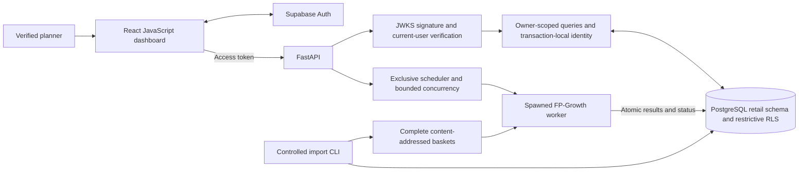
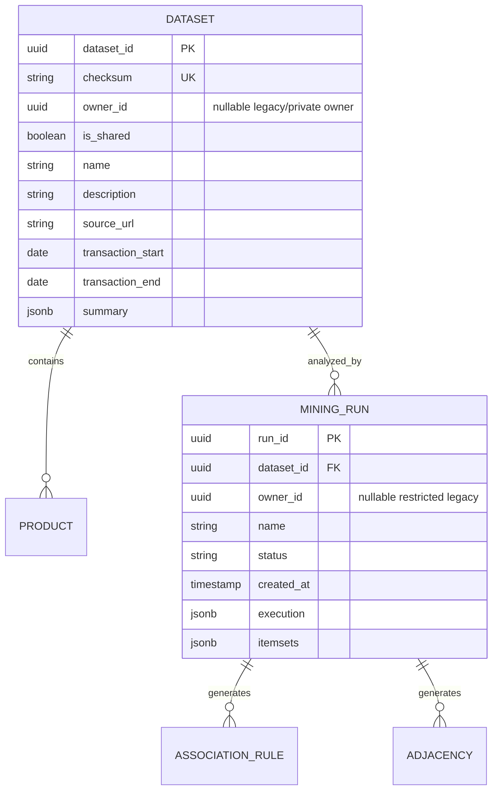

# Architecture

The existing modular monolith is preserved. Python calculates production metrics; React formats persisted evidence and draws conceptual product relationships. No predictive model training or physical floor-plan optimization is implied.

## Request and mining flow

One ignored root `.env` supplies local configuration. `backend/app/config.py` owns validated server settings and engine/session creation. `frontend/env-public.js` projects only three approved public settings into Vite; automatic environment-prefix exposure is disabled. `frontend/src/config.js` is the browser configuration interface. Hosted process environment values override local files. Database/owner/service-role secrets never belong in frontend settings.

## Authentication and ownership

Supabase owns passwords, email verification, recovery, refresh tokens and sessions. The frontend restores sessions through the SDK, protects application entry, cancels requests on identity changes and remounts private state across accounts. No shared operator password or custom password table exists. Theme/sidebar preferences are non-sensitive browser preferences.

FastAPI accepts verified ES256/RS256 access tokens with the configured issuer, `authenticated` audience/role, expiration, issued-at and UUID subject. It also checks the current verified user with Auth's user endpoint. JWKS keys are cached for rotation. User IDs from request bodies/query parameters never authorize a record. Access-token validity after logout is subject to Supabase JWT expiry; immediate invalidation of every issued JWT is not claimed.

Datasets are shared read-only or private to an owner. Every run/status/name/history/itemset/rule/graph/report/CSV lookup checks the verified owner. Legacy runs with NULL owners remain restricted to maintenance access; no new signup inherits them. RLS is defense in depth: restrictive ownership policies intersect runtime grants, while SQLAlchemy applies `retail.user_id` and `retail.maintenance` with transaction-local `set_config`. Commit/rollback resets pooled identity; the listener reapplies it on each new transaction. The controlled CLI/worker explicitly uses maintenance sessions. A fixed-scope security-definer boolean function reports global mining occupancy without exposing other users' records.

The `retail` schema stays outside Supabase's exposed Data API schemas. The runtime role has SELECT/INSERT/UPDATE only, no owner/migration administration. Migration credentials are used only on a trusted machine. Auth users remain in Supabase Auth; no duplicate accounts table was introduced.

## Data model and migrations

Products use a dataset/code composite key. Adjacency has composite foreign keys to both product endpoints and the run's dataset, canonical `product_a < product_b` ordering and a unique run/pair constraint. UTC timestamps, finite validated thresholds, atomic completion and bounded itemset responses preserve integrity. Raw source/customer rows are not stored in PostgreSQL.

Migrations are additive: 001 original schema; 002 ownership/RLS; 003 provenance/date metadata; 004 run names; 005 partial owner/creation/run history index. Each was exercised in a unique disposable schema before applying to the existing application schema. No records were dropped or reassigned.

## Mining and recovery

The importer validates source columns, applies deterministic exclusions, groups invoice-level baskets and writes atomic content-addressed artifacts. Verified source checksum identifies UCI; other datasets keep their own provenance. Missing-artifact repair preserves already verified custom metadata and ownership. Every eligible invoice remains in the denominator; quantities signify presence, not weight. No sampling or product truncation was added.

The existing sparse Boolean FP-Growth pipeline remains in place. Released mlxtend 0.25.0 removes unnecessary upstream null-handling allocations; compatible pandas/NumPy upgrades preserve the complete result digest. Association metrics, canonical pairs and deterministic ranking are unchanged.

POST `/api/v1/runs` validates dataset/artifact/configuration and the account's hourly limit, serializes simultaneous submissions with a transaction advisory lock and permits one active job globally. One scheduler holds a session advisory lock. Its child is bounded by address space and wall time. Results and Completed status commit atomically; failures/timeouts retain safe Failed records. Restart or connection recovery marks interrupted jobs Failed only after exclusive lock acquisition. Recovery stops/reaps a child and reconnects with interruptible exponential backoff capped by configuration. It never silently reruns an interrupted analysis.

The default SQLAlchemy pool is five connections and zero overflow **per process**, with acquisition/connect/statement/lock limits, recycling and health checks. The scheduler consumes a parent pool connection; the mining child uses its own process-local engine. Size hosting connection budgets accordingly.

## API and client responsibilities

Existing `/api/v1` routes remain: health; datasets; dataset summary; create/status runs; rules; adjacencies; report; CSV; itemsets. Added GET runs supports authorized search, dataset/status/date filters, bounded pagination and sort; PATCH run renames an owned run; GET account returns verified identity. Page size is bounded to 100. Authentication is required on account/data routes; health contains only availability. Common responses: 401 invalid/missing session; 403 unverified identity; 404 unavailable/unauthorized record; 409 busy/not-ready/artifact; 422 invalid input; 429 account submission limit; 503 database/Auth/scheduler outage.

Catalog reads avoid N+1 run lookups. Status/history omit heavy itemsets. Product search runs in SQL and only required labels are fetched for returned rows; CSV intentionally retrieves all authorized recommendation rows and neutralizes spreadsheet formulas. No engine is created per request.

`App.jsx` coordinates navigation, catalog/run selection and cancellable results; `auth.jsx` owns account sessions/forms; `Account.jsx`, `Sidebar.jsx` and Radix overlays manage accessible account/navigation UI; `RunSelector.jsx` owns searchable history; `Overview.jsx` and `Results.jsx` render evidence; `Graph.jsx` preserves SVG zoom/pan/details; `ui.jsx` and CSS/Tailwind tokens own shared styling. GitHub Dark is default. Search is debounced, stale requests abort, filter/page changes are atomic and terminal/off-screen polling stops. Overview retains inline history; run popovers/details appear on analysis pages only. Tables allow vertical scroll chaining and horizontal keyboard/wheel access.

See [improvement evidence](improvement-report.md) for measurements, test boundaries and production limitations.
