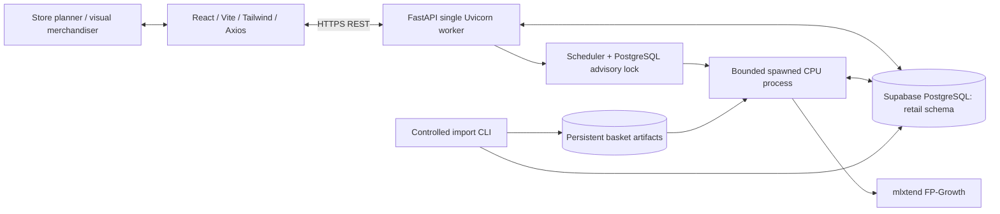
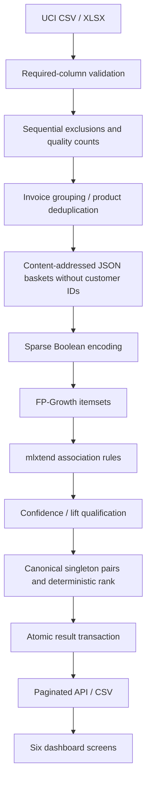
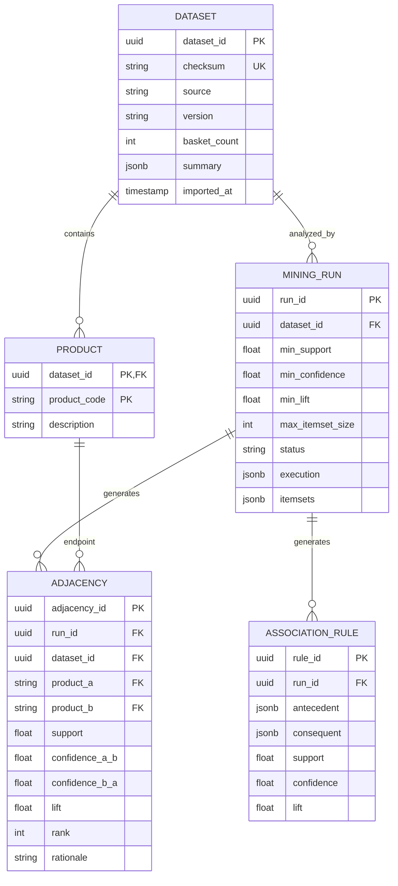

# Architecture
The application is a modular monolith. Python performs every production metric calculation. The browser only formats evidence and draws the returned pairs.

## High-level design

## Low-level design and data flow

Every eligible invoice contributes one denominator unit. Positive quantity signifies presence rather than a weight. Missing customer IDs do not exclude invoices. No random sampling or arbitrary product truncation occurs.

## Entity relationships

Adjacency uses composite foreign keys to both product endpoints and the run's dataset. `product_a < product_b` and unique run/pair constraints prevent self-pairs and reverse duplicates. Timestamps are timezone-aware UTC. Results, metadata and status completion commit together. Itemsets are bounded to 100,000 records and stored as JSONB; raw source rows are not persisted.

## API and execution flow
POST `/api/v1/runs` validates the operator bearer token, dataset artifact and thresholds, takes a transaction advisory lock, checks active runs and commits Queued. The scheduler commits Running, spawns one child, and monitors a wall-clock limit. Child address-space limit defaults to 2 GiB. On success all results commit atomically with Completed; exceptions/timeouts become Failed with safe text. Reads return 409 until completed. Startup marks interrupted Queued/Running jobs Failed rather than claiming durable retry. A session advisory lock rejects a second application worker. Shutdown explicitly releases it before connection pooling.

Routes: health; datasets; dataset summary; create run; run status; rules; adjacencies; report; CSV export; paginated itemsets. Unknown UUIDs return 404, invalid input 422, unauthorized mining 401, busy/not-ready 409, database failures 503. Rule search matches names/codes; sort is allowlisted; page size is at most 100. Reports and graph consume the same persisted adjacency rows. CSV neutralizes formula prefixes.

## Responsibilities and boundaries
- `config.py`: environment settings, PostgreSQL engine/session; Supabase requires sslmode.
- `models.py`: integrity constraints and ORM only.
- `schemas.py`: request validation and response contracts.
- `mining/preprocessing.py`: deterministic cleaning, names and sparse presence matrix.
- `mining/pipeline.py`: FP-Growth, rule filtering and pair ranking, independent of HTTP/database.
- `worker.py`: single-process scheduling, restart recovery and atomic persistence.
- `main.py`: HTTP routing, auth, pagination, serialization and CORS.
- `scripts/`: owner-controlled acquisition, import, credentials, role setup and smoke verification.
- Frontend `api.js`: Axios configuration and CSV download; `App.jsx`: navigation/API state and polling; `Overview.jsx`: dashboard/quality; `Results.jsx`: dataset/mining/results screens; `Graph.jsx`: graph/evidence; `ui.jsx`: shared controls; `theme.js`: appearance; `Icon.jsx`: SVG icon set. See ui-refresh.md for theme/accessibility verification.

Private `retail` schema is outside default Supabase Data API schemas. Public and API roles get no grants; RLS policies grant the scoped runtime role. Do not add `retail` to exposed schemas. Runtime cannot create/drop tables or administer the database. Read endpoints expose product-level aggregates, never customer identifiers. Migration credentials are never needed by the web process on Render.
