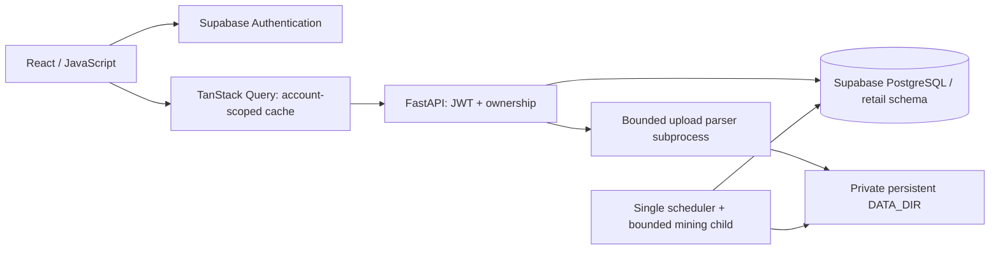

# RetailAtlas architecture

The existing JavaScript/React and FastAPI modular monolith is retained. PostgreSQL/Supabase replaces the PRD's SQLite proposal. Python computes mining metrics; the browser formats persisted evidence and draws conceptual relationships.

## Runtime flow

`AuthProvider` restores/refreshes Supabase sessions, verifies recovery callbacks and aborts requests on account changes. Each authenticated identity receives a separate mounted QueryClient. Obsolete requests consume AbortSignal; private caches clear after unmount. JWT signatures, issuer, audience, expiry and authenticated identity remain backend checks; the Auth user endpoint also checks the current verified account.

## Pages and shell

The shared shell contains branding, eight workspace links, a separated Account link, header controls and minimal footer. Desktop sidebar widths are 236/64 px; mobile navigation uses a Radix dialog. Theme/sidebar preferences persist locally.

| Destination | Stable hash | Data ownership |
|---|---|---|
| Overview | `#overview` | Catalog, selected-run summary, top three pairs, five recent runs |
| Datasets | `#datasets` | Bounded catalog, selected provenance/quality, private dataset actions |
| Dataset Upload | `#datasets/upload` | Upload configuration, bounded preview/mapping, processing result |
| Mining Configuration | `#mining/configuration` | Ready datasets, parameters, idempotent submission |
| Mining Execution | `#mining/execution` | Selected execution and searchable paginated history |
| Association Rules | `#rules` | Selected run, server-filtered directional rules |
| Product Relationship Map | `#layout` | Selected run, ten bounded adjacency edges, relationship inspection |
| Reports | `#reports` | Selected run, evidence/thresholds, paginated pairs and complete CSV |
| Account | `#account` | Account/profile only; no analytics requests |

Optional `run`/`dataset` hash query parameters preserve selection on reload and back/forward. `#mining` and optional leading-slash hashes remain compatible. UUIDs are internal selection identifiers, not manual-entry controls.

Shared components include Sidebar, UserMenu, DatasetSelector/SearchSelect, RunSelector, RunHistory, Status, Notice, skeletons, pagination and semantic design tokens. Radix supplies portal positioning, outside/Escape dismissal and focus restoration. Configuration, upload, account, analytics and graph modules load separately.

Queries use account/resource/run/filter keys and 30-second freshness, bounded retries and targeted invalidation. Execution polling stops at terminal states and off the execution page. Results preserve valid same-run data during background queries; switching runs remounts incompatible filters/results. Run-selector requests are cancelled on dismissal/unmount. Catalog search currently covers its bounded 100 returned entries.

## Upload and artifact storage

`POST /datasets/preview` streams a bounded raw file to a generated private staging path and invokes an isolated parser for headers and at most eight sample rows. Alias mapping is automatic only when unambiguous. `POST /datasets` receives the confirmed file/mapping, validates the entire bounded source and persists dataset/products only after source and baskets are published atomically.

Required fields: InvoiceNo, StockCode, Quantity. Description/date/price/country are optional; CustomerID is unnecessary. CSV must be UTF-8, including optional BOM; common delimiters are detected. XLSX uses read-only parsing, defused XML, one worksheet and no evaluated formulas/macros. File size, transfer time, parser time/address space, row/column/cell limits and expanded workbook size are bounded.

Defaults: 50 MiB source, 600,000 rows, 40 columns, 120 MiB expanded workbook, 100,000 baskets, 10,000 products, 200-character identifiers and 1,000-character descriptions. One parser slot prevents competing memory-heavy imports. Blocking parsing/database work runs outside the ASGI event loop.

Private storage identity hashes owner, source content and canonical mapping. Identical retries return the same authorized dataset; another account gets its own identity. Sources use `DATA_DIR/sources/<generated-hash>.<format>`; baskets retain the worker-compatible `<hash>.json` contract. Source files are mode 0600 and source directories 0700. No raw filenames become paths. Publication failures remove newly published artifacts; ordinary failures remove staging directories. `cleanup_uploads.py` defaults to a dry run and identifies only old, unreferenced upload remnants. Referenced files and the original UCI source/artifact remain protected.

This is durable storage only when `DATA_DIR` is on a persistent volume. Private Supabase Storage was evaluated; provisioning, bucket policies, worker access and cost were not assumed or enabled. Ephemeral hosting filesystems are unsuitable.

Private datasets can be renamed, downloaded if retained, or archived with confirmation. Archival preserves all historical dependencies and refuses active runs. Shared data cannot be modified through these operations. There is no destructive dataset-delete endpoint.

## Database and mining

Existing Dataset/Product/MiningRun/AssociationRule/Adjacency entities and constraints remain. Migration 006 adds nullable `submission_key` plus a partial unique owner/submission index; historical rows are untouched. Query/admission locking returns a previously persisted matching submission before queue/rate checks. Reusing a key with changed parameters returns 409.

Ownership is explicit in HTTP queries and reinforced by restrictive RLS with transaction-local identity. Pooled sessions clear identity at transaction end. Legacy ownerless runs remain restricted. The runtime role remains separate from migration credentials; Supabase Data API roles do not receive these table grants.

One scheduler owns a PostgreSQL advisory lock. Admission allows one active job globally and defaults to six submissions/account/hour. A spawned process receives memory/time limits. Queued, Running, Completed and Failed are persisted; worker start time is instrumented. No cancellation, queue positions, percentages or ETA are invented. Restart/connection-loss recovery fails interrupted jobs for explicit resubmission. Existing lock/reconnect/watchdog tests remain.

FP-Growth preserves invoice baskets, Boolean presence, the complete support denominator, directional confidence/lift, canonical undirected pairs and deterministic ranking. Missing reverse confidence stays NULL. PostgreSQL `greatest` ignores missing directions when applying the either-direction threshold. The graph uses actual connectivity groups, stable D3 layout and collision-aware packing; it is not a physical floor plan.

## Verification boundary

The platform browser suite uses a tracked, sanitized **public UCI aggregate fixture**. Test identities and deterministic IDs never enter production code. The separate upload suite launches a loopback-only API, disposable PostgreSQL database and real worker with controlled authentication. Production JWT/RLS checks are tested separately with signed claims and two identities. A second live Supabase account and hosted email delivery remain external checks.
